# Manual de usuario e instalación — SmartGym v2 (Stronger Aragón)

Este manual está escrito para alguien **sin conocimientos técnicos**. Cada
comando de instalación indica exactamente qué debe aparecer en pantalla si
salió bien. Todos los pasos de este documento fueron ejecutados y
comprobados por quien lo escribió, levantando una copia nueva y aislada del
sistema desde cero (mismo procedimiento que `docs/PUESTA-EN-PRODUCCION.md`)
y siguiendo este manual al pie de la letra. Las capturas de pantalla son
reales, tomadas durante esa verificación — no son maquetas.

Al final de este documento hay una sección que dice **qué se probó y qué
no** durante esa verificación.

---

## 1. Requisitos

Necesitas 4 cosas instaladas en tu computadora antes de empezar:

| Requisito | Versión mínima probada | Para qué sirve |
|---|---|---|
| **Docker Desktop** | 29.6.1 (incluye Docker Compose v5.3.0) | Levanta los 3 programas del sistema (base de datos, backend, frontend) sin que tengas que instalar nada más a mano. |
| **Git** | 2.55 | Para descargar ("clonar") el código del sistema a tu computadora. |
| **Puertos libres** | 5173, 8000 y 5432 | El sistema usa estos 3 números de puerto en tu computadora. Si algo más los está usando, el sistema no arranca (ver sección 6). |
| **Espacio en disco** | Al menos 3 GB libres | Las 3 imágenes de Docker (backend, frontend y la base de datos PostgreSQL) ocupan en conjunto poco más de 1.6 GB; Docker necesita espacio adicional para construirlas y para sus archivos temporales. |

No es necesario tener Python, Node.js ni PostgreSQL instalados en tu
computadora: todo corre dentro de Docker.

### Cómo comprobar que están instalados

Abre una ventana de **PowerShell** (busca "PowerShell" en el menú de
inicio de Windows) y escribe estos comandos, uno por uno, presionando
Enter después de cada uno:

```bash
docker --version
docker compose version
git --version
```

Si los 3 responden con un número de versión (por ejemplo `Docker version
29.6.1, build 8900f1d`), están listos. Si en vez de eso ves un error como
`'docker' no se reconoce como un comando...`, ese programa no está
instalado — descárgalo primero (Docker Desktop desde
[docker.com](https://www.docker.com/products/docker-desktop/) y Git desde
[git-scm.com](https://git-scm.com/)) y vuelve a intentar.

**Importante:** instalar Docker Desktop no es suficiente — también tiene
que estar **abierto y corriendo**. Si lo acabas de instalar o tu
computadora se acaba de reiniciar, abre la aplicación "Docker Desktop"
desde el menú de inicio y espera a que el ícono de la ballena en la
barra de tareas deje de animarse antes de continuar. Si no lo abres,
cualquier comando `docker` de este manual falla con un mensaje parecido
a `failed to connect to the docker API... El sistema no puede encontrar
el archivo especificado` — esto fue reproducido tal cual durante la
verificación de este manual.

### Cómo comprobar que los puertos están libres

En PowerShell:

```bash
netstat -ano | findstr "5173 8000 5432"
```

Si no aparece ninguna línea, los 3 puertos están libres y puedes seguir.
Si aparece alguna línea, algo en tu computadora ya está usando ese
puerto — ver la sección 6 ("Puerto ocupado") para resolverlo antes de
continuar.

---

## 2. Instalación paso a paso

Todos estos comandos se ejecutan en PowerShell. Puedes copiar cada bloque
y pegarlo en la ventana (clic derecho para pegar), presionando Enter
después de cada uno.

### 2.1 Clonar el proyecto

Elige una carpeta donde quieras guardar el sistema (por ejemplo, tu
carpeta de Documentos) y entra a ella:

```bash
cd C:\Users\TU_USUARIO\Documents
git clone <URL-del-repositorio> SmartGym-v2
cd SmartGym-v2
```

**Qué debes ver:** una serie de líneas terminando en `Receiving
objects... done.` y una nueva carpeta `SmartGym-v2` con el código dentro.
No debe aparecer ningún `error` ni `fatal`.

### 2.2 Copiar el archivo de configuración

```bash
copy .env.example .env
```

**Qué debes ver:** el mensaje `        1 archivo(s) copiado(s).` y un
nuevo archivo `.env` junto a `.env.example`.

**¿Qué hay dentro de `.env` y qué se puede cambiar?**

El archivo trae 5 valores, todos pensados para uso local/de prueba:

| Valor | ¿Se puede cambiar? |
|---|---|
| `POSTGRES_DB`, `POSTGRES_USER`, `POSTGRES_PASSWORD` | Solo si sabes lo que haces — son el nombre y las credenciales de la base de datos que Docker va a crear. Cambiarlos no rompe nada siempre que los cambies **antes** del primer `docker compose up`, pero no aportan nada en un uso local. |
| `DATABASE_URL` | **No lo toques.** Ya está armado a partir de los 3 valores anteriores (usuario, contraseña y nombre de base de datos) y del nombre interno `db` que usa Docker para encontrar la base de datos. Si cambias `POSTGRES_USER` o `POSTGRES_PASSWORD` sin actualizar también esta línea, el backend no podrá conectarse. |
| `JWT_SECRET` | Para uso local, déjalo igual. El propio archivo lo marca como "solo desarrollo" — en un uso real este valor se genera distinto y nunca se comparte (ver sección 7). |
| `VITE_API_URL` | **Este valor no tiene ningún efecto dentro de Docker** — es un detalle real del sistema que se confirmó durante esta verificación: el archivo `docker-compose.yml` no se lo pasa al contenedor del frontend, así que cambiarlo en `.env` no cambia nada en la práctica. El frontend siempre busca el backend en `http://localhost:8000`. Solo tiene efecto si decides correr el frontend fuera de Docker. No lo edites esperando que algo cambie. |

Para un primer uso, **no cambies nada** — copia el archivo tal cual y
sigue al siguiente paso.

### 2.3 Levantar el sistema

```bash
docker compose up --build -d
```

La primera vez tarda varios minutos (Docker descarga e instala todo
desde cero). Las siguientes veces es mucho más rápido.

**Qué debes ver:** al final, 3 líneas parecidas a:

```
 Container smartgym-db-1        Started
 Container smartgym-backend-1   Started
 Container smartgym-frontend-1  Started
```

No debe aparecer `Error` en ninguna línea. Para confirmar que los 3
programas quedaron corriendo:

```bash
docker compose ps
```

**Qué debes ver:** una tabla con 3 filas (`smartgym-db-1`,
`smartgym-backend-1`, `smartgym-frontend-1`), todas con estado `Up` (la
de la base de datos además dice `(healthy)` después de unos segundos).

### 2.4 Preparar la base de datos (migraciones)

Este paso crea las tablas dentro de la base de datos. **Solo hace falta
la primera vez** que levantas el sistema (o si lo borraste todo y
empiezas de cero):

```bash
docker compose exec backend alembic upgrade head
```

**Qué debes ver:** 4 líneas que empiezan con `INFO [alembic...] Running
upgrade`, terminando en la migración `0004`. Ningún `Traceback` ni
`Error`.

### 2.5 Cargar datos de ejemplo (opcional pero recomendado)

Este paso crea las 3 cuentas de prueba y datos de ejemplo (un cliente,
una rutina, una dieta, etc.) para que no empieces con el sistema vacío:

```bash
docker compose exec backend python seed.py
```

**Qué debes ver:** una serie de líneas describiendo lo que se va
creando, terminando en:

```
Listo. Cuentas demo (todas con password: Demo2026! ):
  admin@demo.com       (admin)
  entrenador@demo.com  (entrenador)
  cliente@demo.com     (cliente, membresía Básica por vencer en 4 días)
```

**Este paso se puede repetir** cuantas veces quieras (por ejemplo, si
quieres volver a tener las cuentas de prueba después de haber jugado con
el sistema) — borra y vuelve a crear los datos de ejemplo cada vez, sin
acumular duplicados.

Con esto, la instalación terminó.

---

## 3. Primer acceso

Abre tu navegador (Chrome, Edge, el que uses normalmente) y entra a:

- **Sistema (lo que vas a usar día a día):** http://localhost:5173
- **Documentación técnica interactiva (Swagger):** http://localhost:8000/docs — esta pantalla es para quien dé soporte técnico al sistema, no hace falta para el uso normal.

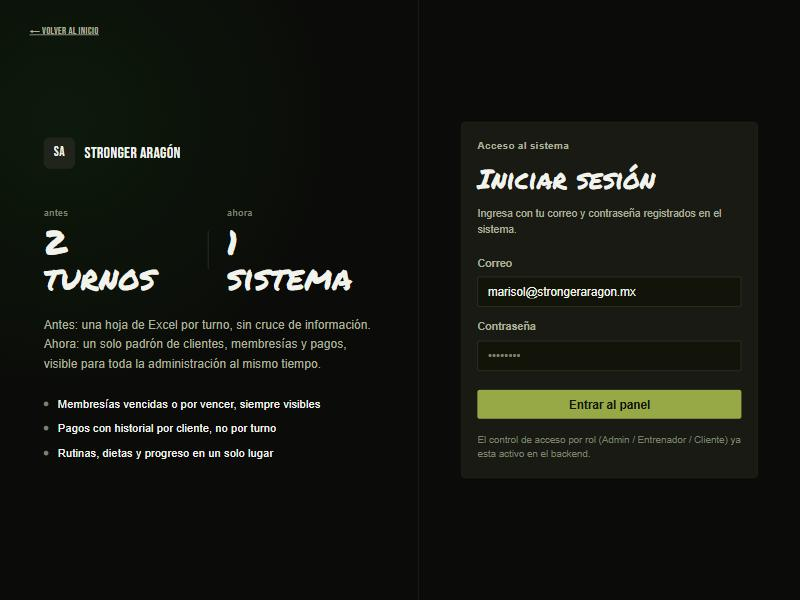

### Cuentas de prueba

El sistema trae 3 cuentas ya creadas (si corriste el paso 2.5), una por
cada tipo de usuario. Todas usan la misma contraseña:

| Rol | Correo | Contraseña |
|---|---|---|
| Administrador | `admin@demo.com` | `Demo2026!` |
| Entrenador | `entrenador@demo.com` | `Demo2026!` |
| Cliente | `cliente@demo.com` | `Demo2026!` |

Escribe el correo y la contraseña en los campos "Correo" y "Contraseña"
y haz clic en **"Entrar al panel"**.

### Cómo cambiar una contraseña

Ningún usuario puede cambiar su propia contraseña desde su sesión — eso
sigue sin existir. Pero **el Administrador sí puede restablecer la
contraseña de cualquier usuario** (cliente, entrenador u otro
administrador) desde la ficha del cliente, pestaña **Perfil**, botón
**"Restablecer contraseña"** — ver sección 4.1 para el paso a paso. No
hace falta conocer ni escribir la contraseña anterior: el sistema genera
una temporal nueva y la anterior deja de funcionar de inmediato.

---

## 4. Guía por rol

### 4.1 Administrador

Al entrar como `admin@demo.com` ves el **Panel general**, con accesos
directos a las tareas más comunes y un resumen ("En números") de
clientes, ingresos del mes y membresías por vencer/vencidas.

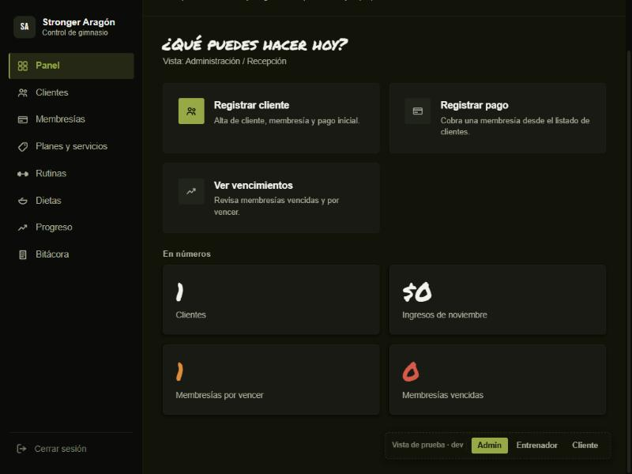

El menú de la izquierda tiene: **Panel, Clientes, Membresías, Planes y
servicios, Rutinas, Dietas, Progreso, Bitácora, Usuarios** y, al final,
**Cerrar sesión**.

#### Alta de un cliente (con membresía y pago inicial)

1. Entra a **Clientes** en el menú lateral y haz clic en **"+ Nuevo
   cliente"**.

   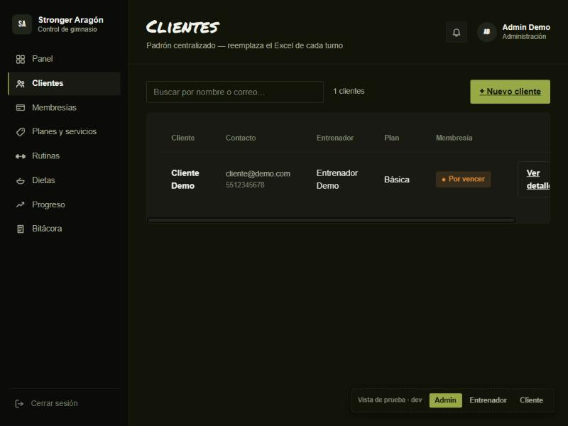

2. Llena los datos del cliente. **Nombre completo, correo, teléfono,
   fecha de nacimiento y dirección son obligatorios** — si falta alguno,
   el sistema lo marca en rojo y no deja continuar. El teléfono de
   emergencia es opcional.
3. En la columna derecha ("Membresía y pago inicial") puedes:
   - Dejarlo en **"Sin membresía por ahora"** y asignársela después
     (ver más abajo), o
   - Elegir un plan (Básica, VIP o Premium). Al elegirlo aparecen
     automáticamente el monto a cobrar, la fecha de pago (hoy) y los
     beneficios incluidos en ese plan.

   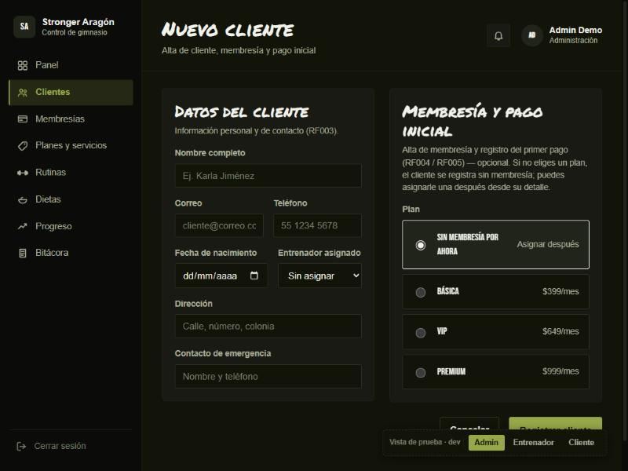

4. Haz clic en **"Registrar cliente"**.

**Qué debes ver:** un aviso verde con el nombre del cliente y una
**contraseña temporal** generada automáticamente (algo como
`MLsBZBhr1neK`). Esa contraseña **solo se muestra esta una vez** — cópiala
y entrégasela al cliente para que pueda iniciar sesión (no hay, por ahora,
forma de volver a verla desde la pantalla; solo se podría recuperar
pidiéndole a soporte técnico que genere una nueva).

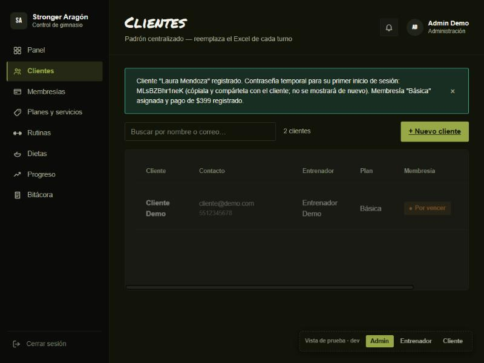

#### Edición de los datos de un cliente

Dentro de la ficha del cliente, pestaña **Perfil**, botón **"Editar
datos"**. Abre un formulario ya prellenado con los datos actuales
(teléfono, fecha de nacimiento, dirección, contacto de emergencia y
entrenador asignado) — cambia solo lo que necesites y haz clic en
**"Guardar cambios"**.

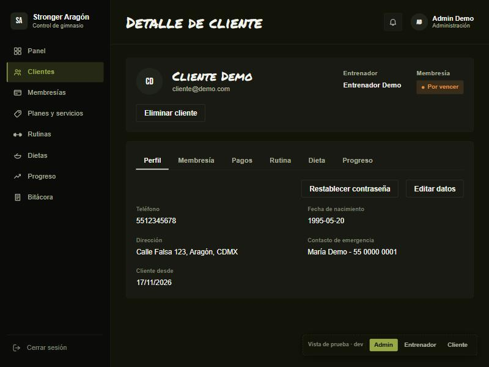

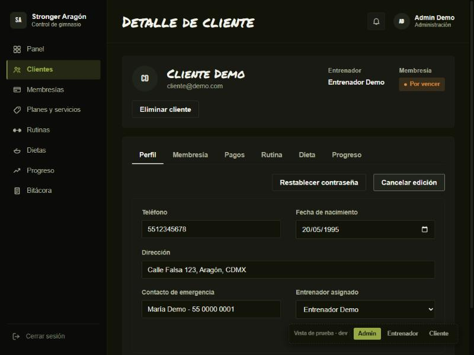

**Qué debes ver:** un aviso verde "Datos del cliente actualizados
correctamente" y los datos nuevos reflejados de inmediato en la pantalla.

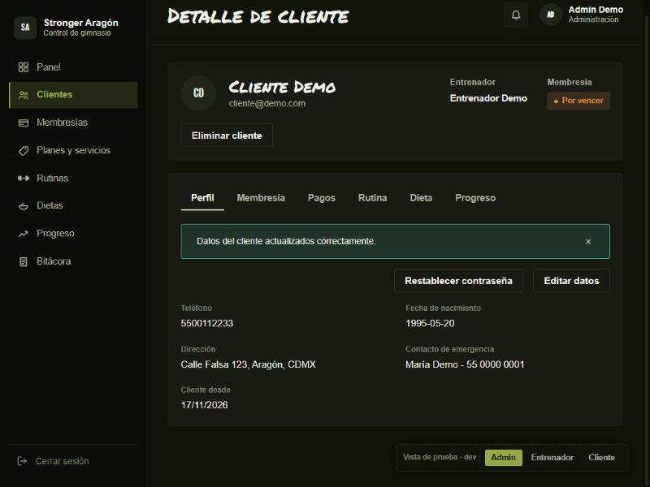

#### Restablecer la contraseña de un cliente (o de cualquier usuario)

Mismo lugar (ficha del cliente, pestaña Perfil), botón **"Restablecer
contraseña"**. El sistema te pide confirmar — te advierte que la
contraseña anterior deja de funcionar de inmediato.

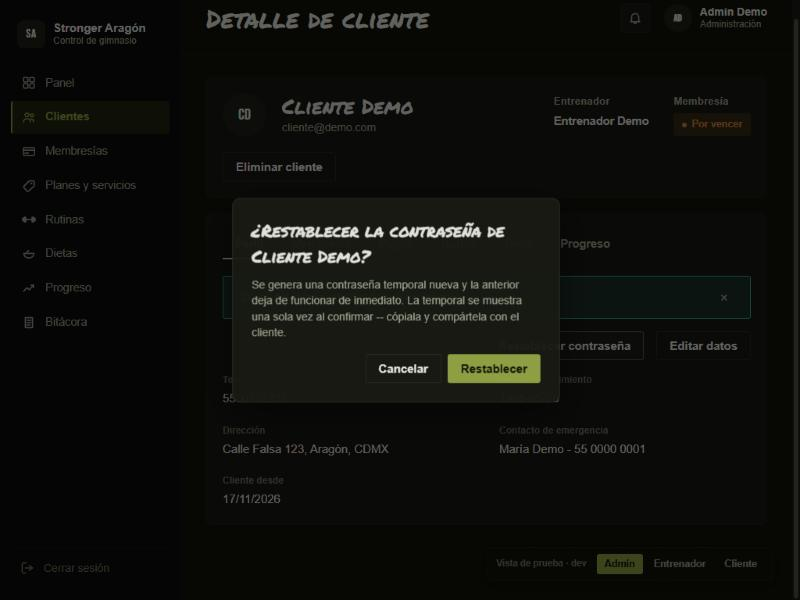

**Qué debes ver:** un aviso verde con una **contraseña temporal nueva**
(algo como `QOyy4pqWI9LY`). Igual que la del alta de un cliente, esta
temporal **solo se muestra una vez** — cópiala y entrégasela a esa
persona de inmediato.

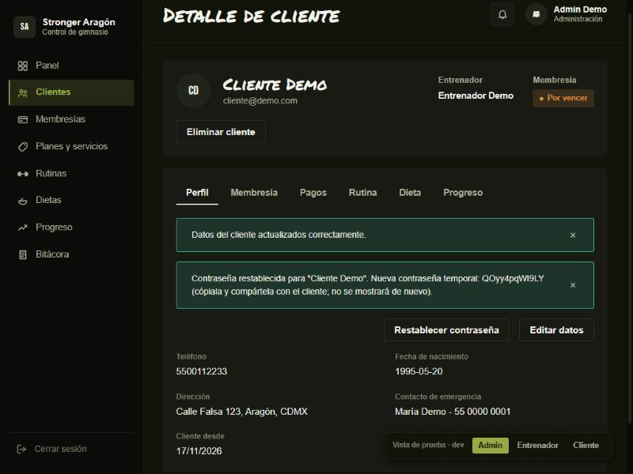

Este mismo botón también existe en la pantalla **Usuarios** (ver más
abajo) para restablecer la contraseña de un entrenador o de otro
administrador — no hace falta pasar por la ficha de un cliente para eso.

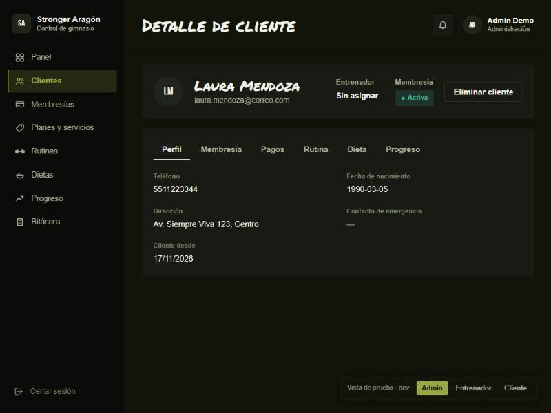

#### Asignar una membresía (a un cliente que no tiene)

Si diste de alta a un cliente sin membresía, entra a su ficha → pestaña
**Membresía**. En vez de los datos del plan verás un aviso ("Este cliente
no tiene una membresía registrada") con un botón **"Asignar membresía"**.

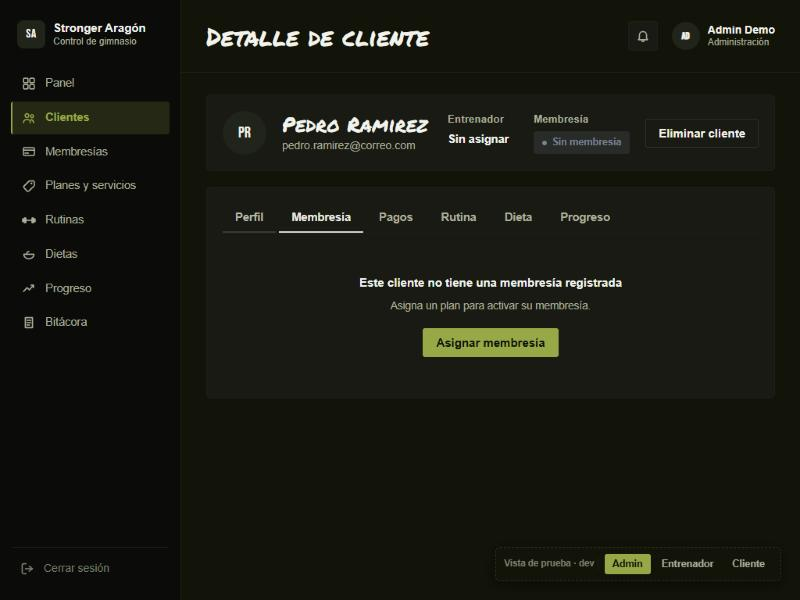

Haz clic ahí, elige el plan y la fecha de vencimiento, y confirma con
**"Asignar membresía"**.

**Qué debes ver:** un aviso verde "Membresía '[nombre del plan]' asignada
correctamente" y los datos del plan (precio, vigencia, beneficios) en su
lugar.

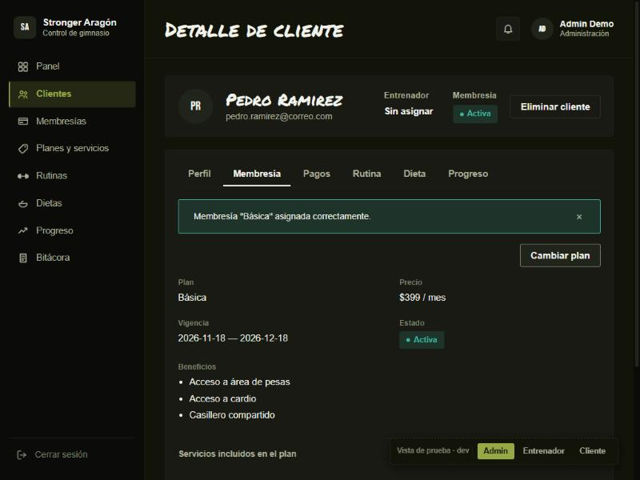

#### Contratar un servicio extra

Dentro de la pestaña **Membresía** de un cliente (que ya tenga plan),
haz clic en **"+ Contratar extra"**, elige el servicio de la lista
(muestra su precio) y confirma con **"Contratar"**.

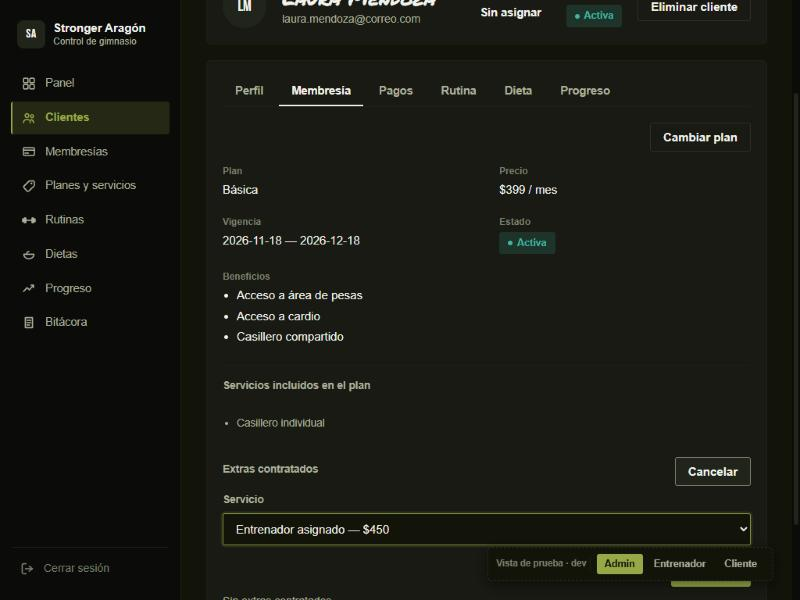

**Qué debes ver:** un aviso verde "'[nombre del servicio]' contratado
correctamente" y el extra aparece en la tabla "Extras contratados" con su
vigencia y estado "Activa".

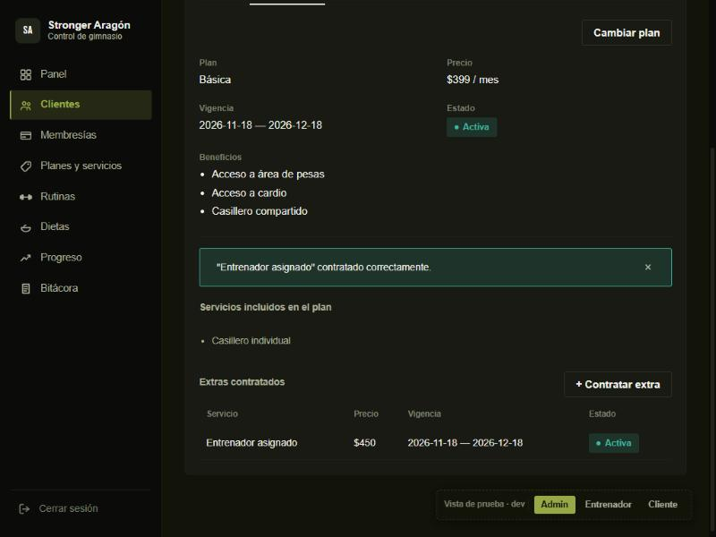

#### Registrar un pago con desglose

Dentro de la ficha del cliente → pestaña **Pagos** → **"+ Registrar
pago"**. Ahí puedes marcar las casillas del plan y/o los extras que se
están cobrando — el monto se calcula solo, sumando cada concepto
marcado.

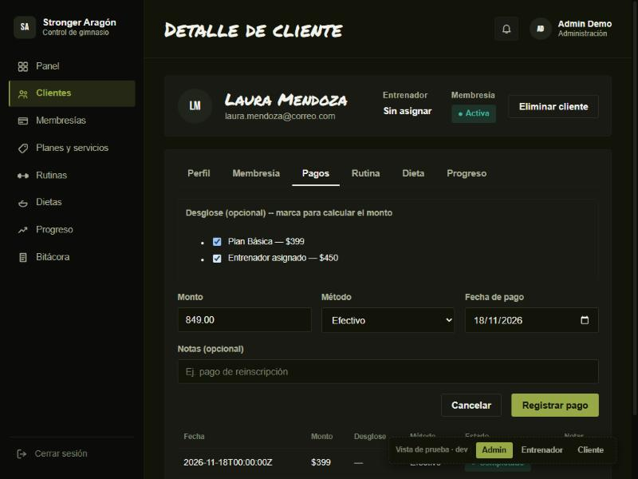

**Qué debes ver:** un aviso verde "Pago registrado correctamente" y una
fila nueva en la tabla de pagos, mostrando el desglose en texto (por
ejemplo "Plan ($399) + Entrenador asignado ($450)").

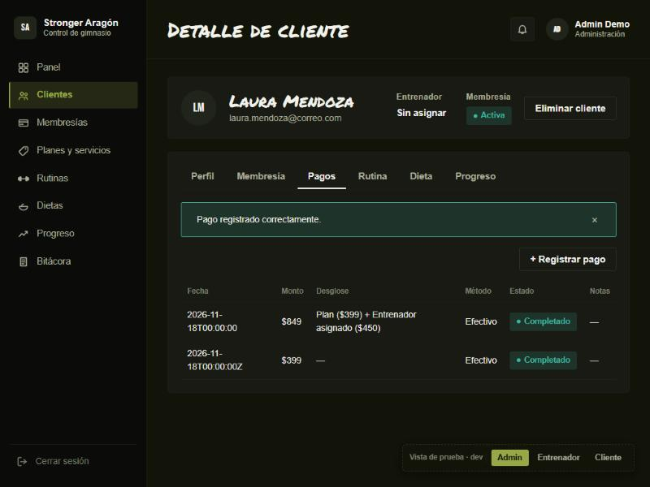

#### Cambiar de plan (con vista previa)

Pestaña **Membresía** → **"Cambiar plan"** → elige el plan nuevo →
**"Ver resumen"**.

**Qué debes ver:** una vista previa que muestra la diferencia de precio
(por ejemplo "Básica ($399) → Premium ($999) +$600 / mes") y, si algún
extra contratado ya viene incluido en el plan nuevo, una lista de lo que
se cancelará automáticamente. Puedes escribir una nota (por ejemplo, un
acuerdo de saldo a favor) antes de confirmar.

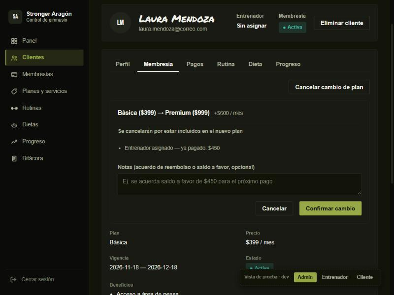

Haz clic en **"Confirmar cambio"**.

**Qué debes ver:** un aviso verde "Plan cambiado a '[nombre]'" y los
datos de membresía actualizados al plan nuevo.

#### Planes y servicios (crear, editar, desactivar)

Entra a **Planes y servicios** en el menú lateral (solo visible para
Administrador). Tiene dos pestañas: **Planes** y **Servicios extra**.

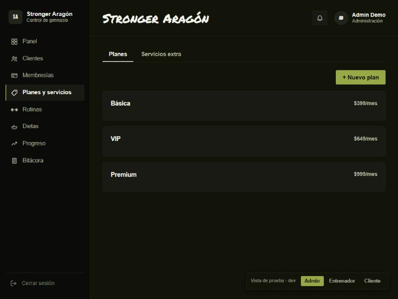

- **Crear:** botón **"+ Nuevo plan"** (o **"+ Nuevo servicio"** en la
  otra pestaña).
- **Editar:** haz clic sobre el nombre del plan/servicio para
  desplegarlo, y luego en **"Editar"**.

  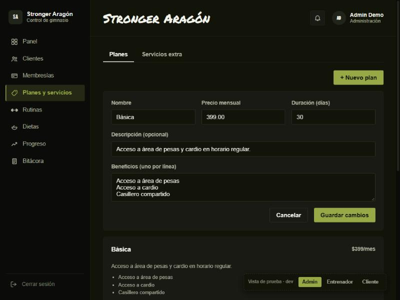

- **Eliminar / desactivar:** el botón dice **"Eliminar"**, pero el
  sistema no siempre borra: si ese plan o servicio ya tiene membresías o
  contrataciones activas, **se desactiva en vez de eliminarse** (deja de
  ofrecerse para clientes nuevos, pero no rompe lo que ya estaba
  contratado). El cuadro de confirmación lo explica exactamente así antes
  de que hagas clic.

  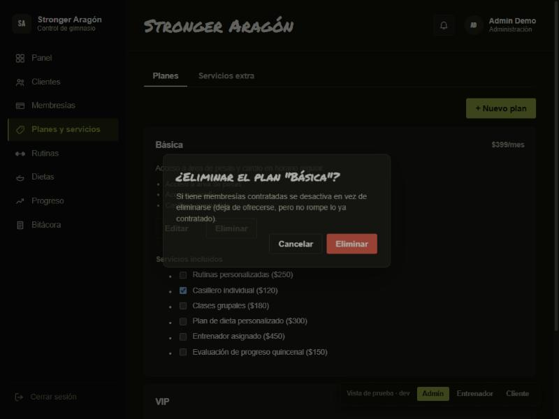

#### Tablero de Membresías activas

Entra a **Membresías** en el menú lateral. Muestra 3 totales
(membresías activas, las que vencen en 7 días o menos, e ingresos del
mes), una tabla con cada cliente y su plan/extras/vigencia, y un botón
**"Revisar vencimientos ahora"** (ver sección 5).

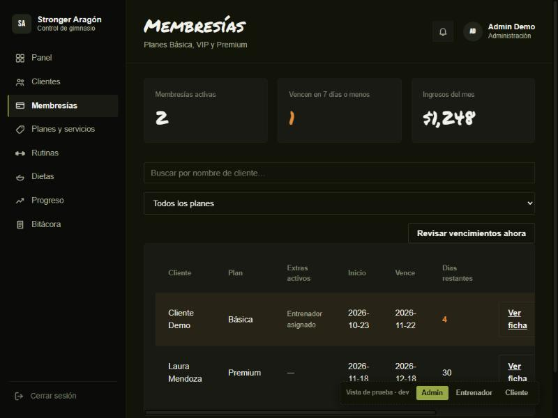

#### Bitácora

Entra a **Bitácora** en el menú lateral (solo Administrador). Aquí
quedan registradas automáticamente las acciones importantes del sistema
(un cambio de plan, un restablecimiento de contraseña, dar de alta a un
usuario, o activar/desactivar una cuenta), con fecha, quién la hizo y el
detalle completo — es de solo lectura, no hay nada que editar aquí.

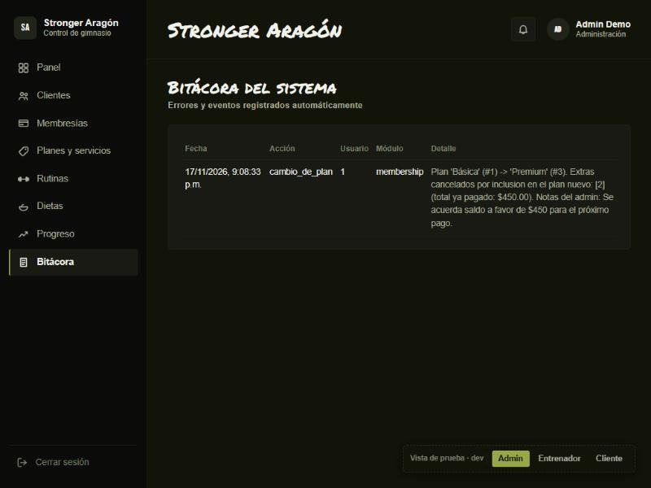

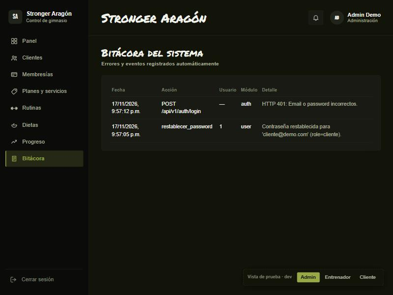

#### Usuarios (administrar cuentas de Admin y Entrenador)

Entra a **Usuarios** en el menú lateral (solo Administrador). Esta
pantalla administra las cuentas de **Administrador** y **Entrenador** —
los clientes NO aparecen aquí, esos se dan de alta y se gestionan desde
**Clientes**.

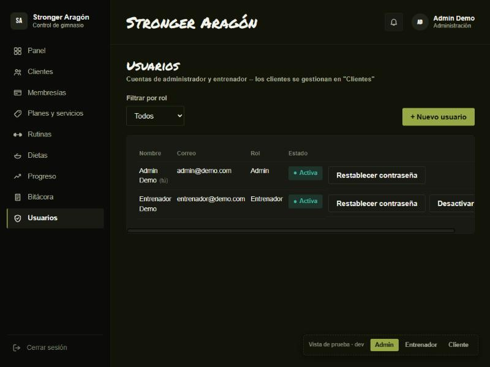

- **Filtrar por rol:** el desplegable "Filtrar por rol" acota la tabla a
  "Admin" o "Entrenador" (o "Todos").
- **Crear una cuenta:** botón **"+ Nuevo usuario"** → nombre completo,
  correo, rol (Admin o Entrenador) y una contraseña inicial (mínimo 8
  caracteres, la escribes tú mismo — a diferencia del alta de un cliente,
  aquí no se genera sola).

  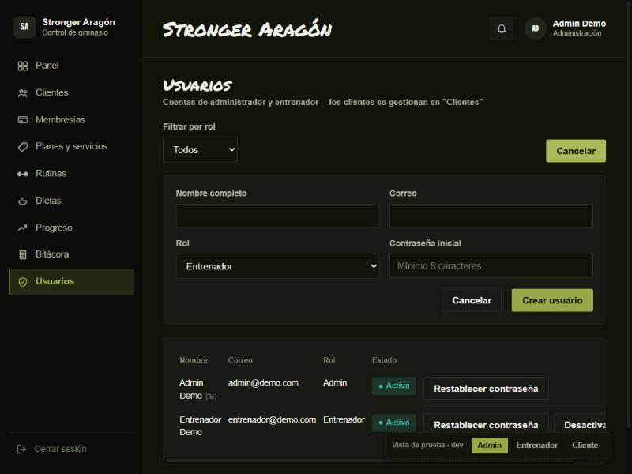

  **Qué debes ver:** un aviso verde "Usuario '[nombre]' creado como
  [rol]." y la cuenta nueva en la tabla, ya con estado "Activa". Si el
  correo ya existe, el sistema lo rechaza con un mensaje claro en vez de
  crear un duplicado.

  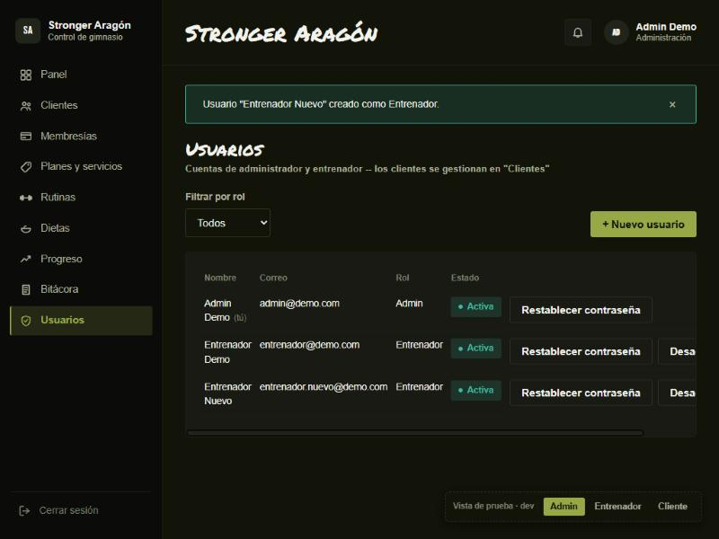

- **Restablecer contraseña:** mismo botón y mismo comportamiento que en
  la ficha de un cliente (ver más arriba) — contraseña temporal nueva,
  mostrada una sola vez.
- **Activar / Desactivar:** botón en la fila de cada usuario. Desactivar
  a alguien le impide iniciar sesión de inmediato (sin borrar su cuenta
  ni su historial); "Activar" se lo devuelve. **Un administrador no
  puede desactivar su propia cuenta** — en su propia fila ese botón ni
  siquiera aparece (se ve la etiqueta "(tú)" junto a su nombre en vez del
  botón).

  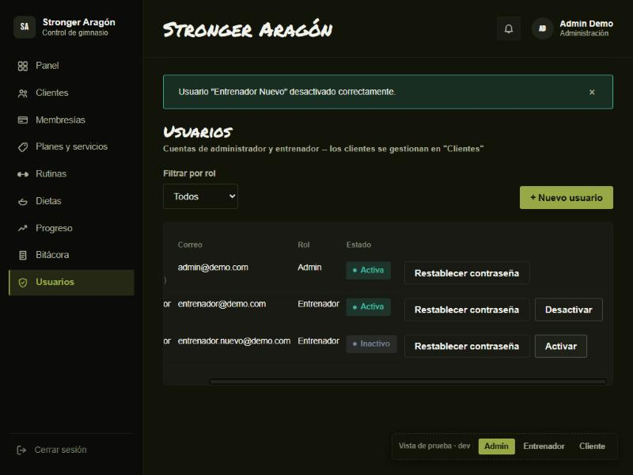

Todas estas acciones (alta, activar, desactivar, restablecer contraseña)
quedan registradas en la **Bitácora**, igual que un cambio de plan.

#### Baja de un cliente

Dentro de la ficha del cliente, botón **"Eliminar cliente"** (arriba a
la derecha). El sistema te advierte exactamente qué se va a borrar junto
con el cliente (su membresía activa, pagos registrados, extras, rutinas,
dietas y progreso) y aclara que **no se puede deshacer**.

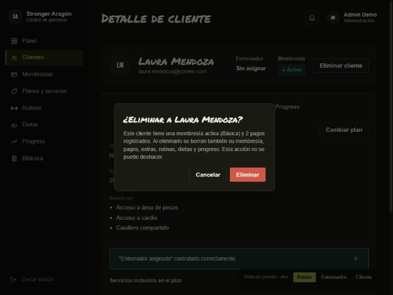

Si confirmas, verás un aviso verde "[nombre] fue eliminado
correctamente" y el cliente desaparece de la lista.

### 4.2 Entrenador

Al entrar como `entrenador@demo.com` el panel cambia: solo ofrece
accesos directos a "Mis clientes", "Asignar rutina" y "Asignar dieta".

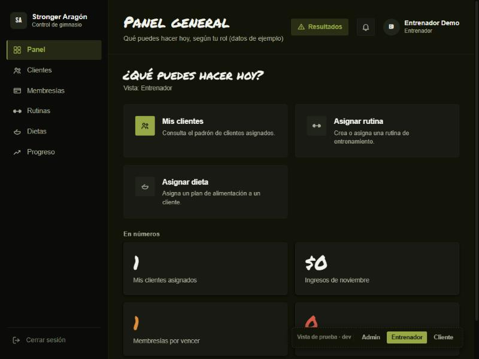

El menú lateral de un entrenador **no tiene** "Planes y servicios",
"Bitácora" ni "Usuarios" — esas pantallas son exclusivas de
Administrador. "Clientes" sí aparece, pero **solo le muestra los
clientes que tiene asignados**,
no el padrón completo (se verificó entrando con ambas cuentas: el mismo
padrón que Admin ve completo, Entrenador lo ve recortado a 1 cliente —
el que tiene asignado — y sin el botón de alta de clientes).

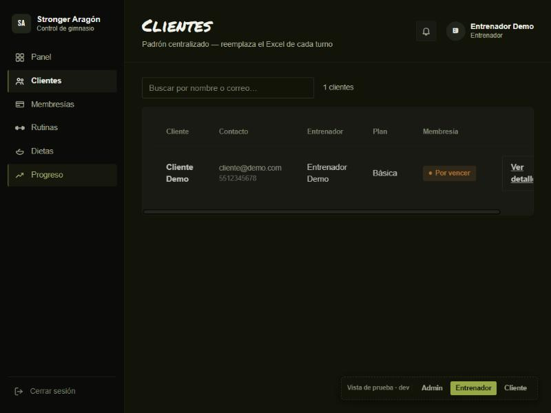

#### Crear y asignar una rutina

Entra a **Rutinas**. A la izquierda está el catálogo de ejercicios/
rutinas (**"+ Nuevo ejercicio"**, **"+ Nueva rutina"**); a la derecha,
elige un cliente en el menú desplegable para ver y asignarle rutinas
(**"+ Asignar rutina"**).

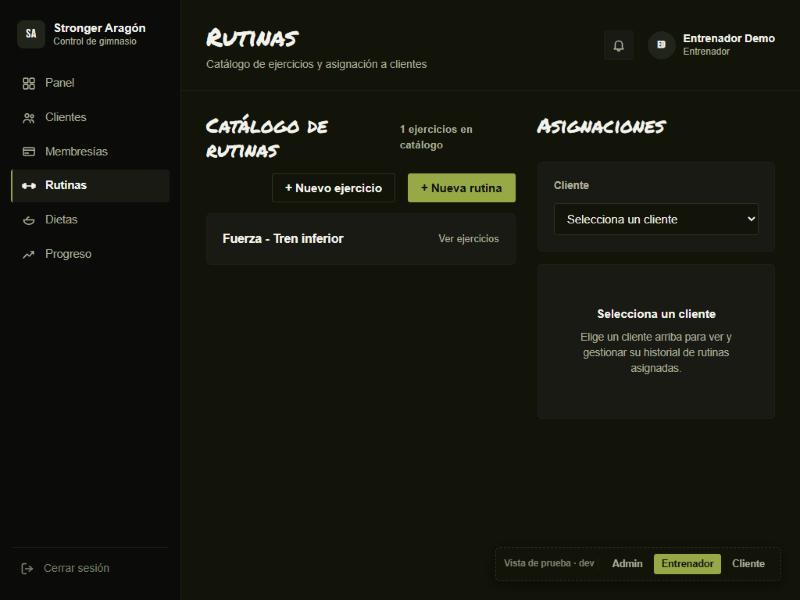

Al elegir un cliente que ya tiene una rutina asignada, la ves en una
tabla con su fecha de asignación y estado (puede cambiarse a
"Completada" ahí mismo).

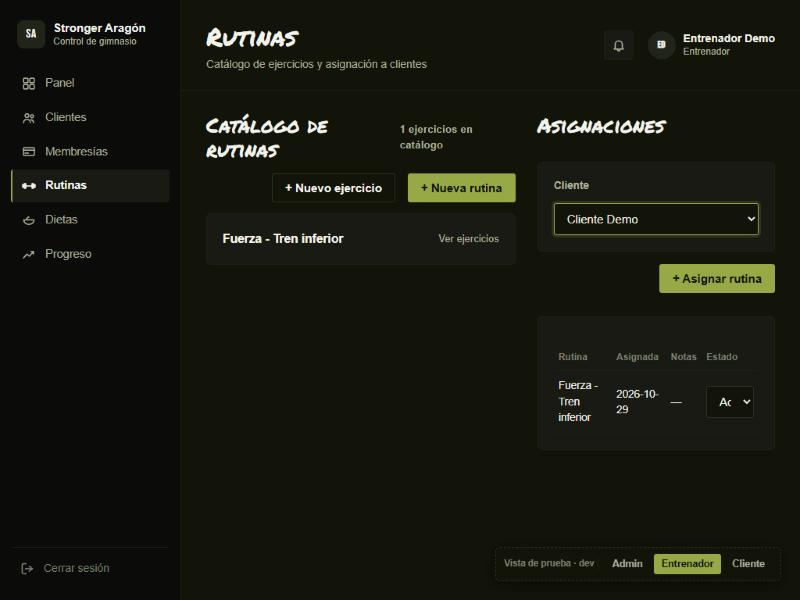

#### Crear y asignar una dieta

Entra a **Dietas** — mismo esquema que Rutinas: catálogo de planes de
alimentación a la izquierda (**"+ Nuevo plan"**), asignación por cliente
a la derecha (**"+ Asignar dieta"**).

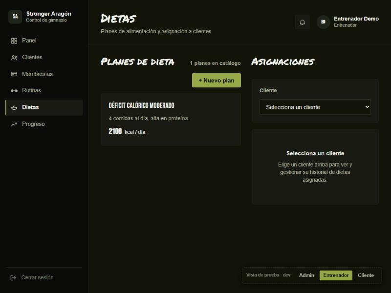

#### Registrar progreso

Entra a **Progreso**, elige un cliente y haz clic en **"+ Registrar
progreso"**. El formulario pide fecha y peso (obligatorios) y, de forma
opcional, estatura, % de grasa corporal, masa muscular y medidas
(cintura, pecho, cadera, brazo).

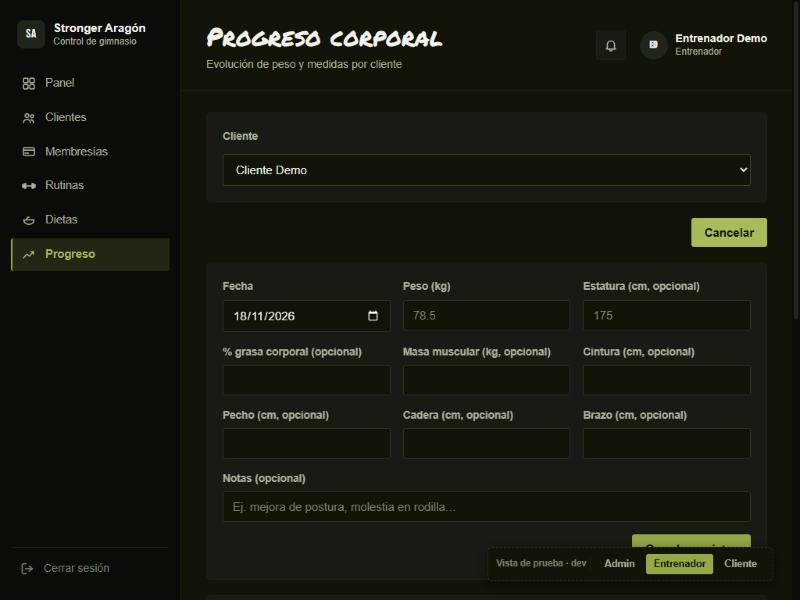

Una vez registrado, el progreso del cliente se ve como una gráfica de
evolución (peso, % de grasa o cintura, según la pestaña que elijas).

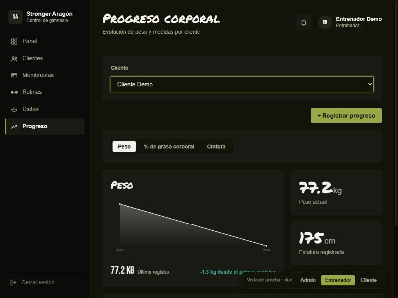

#### Qué ve y qué no ve el entrenador

- Ve: sus clientes asignados (no el padrón completo), Membresías (igual
  que Admin, incluyendo el tablero de ingresos — esto se confirmó tal
  cual aparece en pantalla), Rutinas, Dietas y Progreso.
- No ve ni puede entrar a: "Planes y servicios", "Bitácora" ni
  "Usuarios" (las tres rutas desaparecen del menú; si un entrenador
  escribe `/usuarios` directo en el navegador, la pantalla igual lo
  bloquea con el mensaje "Solo el administrador puede administrar
  cuentas de usuario" — se verificó esto en el navegador).

  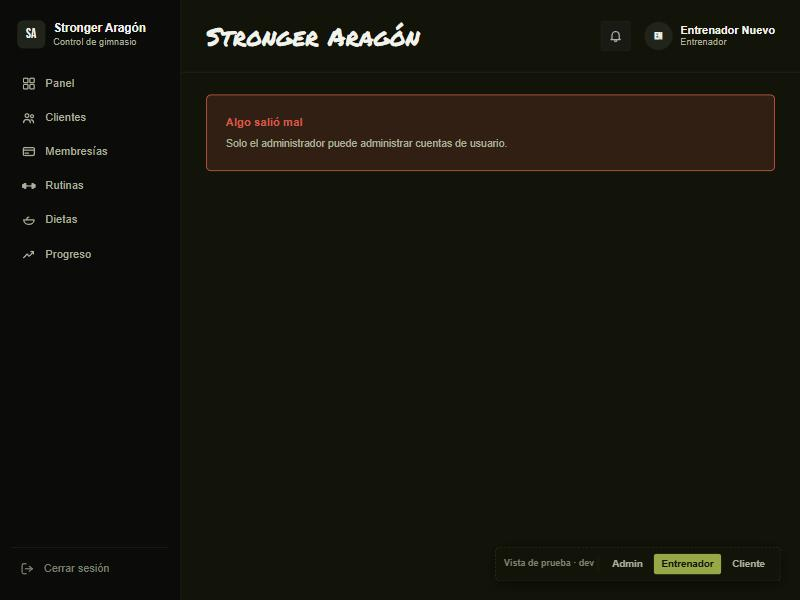
- No puede: dar de alta/baja clientes, registrar pagos, cambiar planes
  de membresía, ni crear/administrar cuentas de usuario — esas
  pantallas son de Administrador.

### 4.3 Cliente

Al entrar como `cliente@demo.com`, el panel muestra únicamente 4
accesos: **"Mi rutina"**, **"Mi dieta"**, **"Mi progreso"** y **"Mi
membresía"** — el propio texto de la pantalla lo aclara: "Vista: Cliente
(solo lectura)".

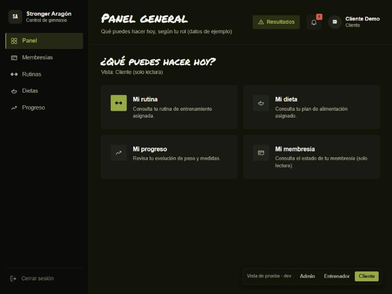

El menú lateral de un cliente **no tiene** "Clientes", "Planes y
servicios", "Bitácora" ni "Usuarios" — solo ve Panel, Membresías,
Rutinas, Dietas y Progreso, y en los tres últimos solo se le muestra su
propia información (nunca la de otro cliente, ni un selector para
elegir a alguien más).

En **Membresías** ve su plan actual, fecha de inicio/vencimiento y
estado (por ejemplo "Por vencer", si está próxima a vencer, con la alerta
en naranja).

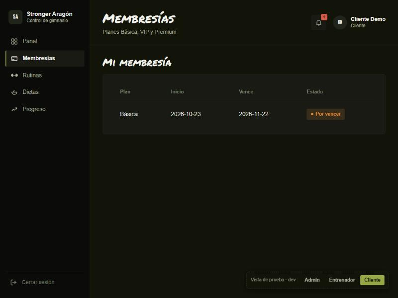

En ninguna de estas pantallas hay botones para editar, contratar,
cancelar ni registrar nada — es exclusivamente para consultar.

---

## 5. Operación diaria

### Apagar y volver a encender el sistema

Para apagarlo (por ejemplo, al final del día) sin perder ningún dato:

```bash
docker compose stop
```

**Qué debes ver:** 3 líneas terminando en `Stopped`.

Para volver a encenderlo (al día siguiente):

```bash
docker compose up -d
```

**Qué debes ver:** 3 líneas terminando en `Started` (no hace falta
volver a poner `--build` salvo que hayas cambiado algo del código).
Todos los datos (clientes, pagos, membresías, etc.) siguen ahí tal como
los dejaste — se comprobó apagando y volviendo a encender el sistema de
prueba y confirmando que los datos seguían intactos.

### Cómo ver que el vencimiento automático corre a las 06:00

Todos los días a las 6:00 a. m. (hora de Ciudad de México), el sistema
revisa automáticamente qué membresías ya vencieron o están por vencer en
los próximos 7 días, y le avisa al cliente correspondiente. Esto corre
solo, sin que nadie tenga que hacer nada — no hay un botón para "ver" que
corrió, pero si entras a la **Bitácora** (solo Administrador) después de
las 6 a. m., vas a encontrar ahí el registro de esa revisión diaria.

Si no quieres esperar hasta las 6 a. m. para ver el efecto (por ejemplo,
para hacer una demostración), en la pantalla **Membresías** hay un botón
**"Revisar vencimientos ahora"** que dispara exactamente la misma
revisión en el momento, sin esperar al día siguiente.

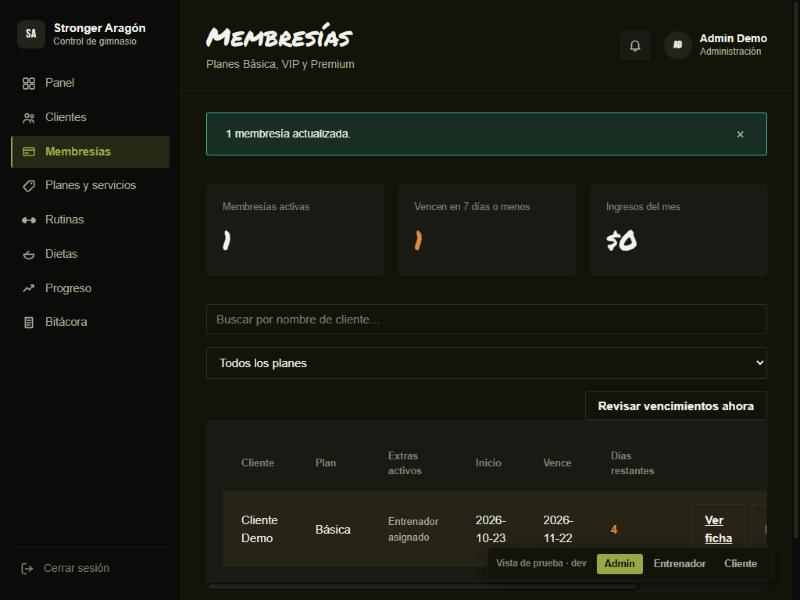

**Qué debes ver:** un aviso verde "[N] membresía(s) actualizada(s)".

### Cómo respaldar la base de datos

```bash
docker compose exec -T db pg_dump -U smartgym -d smartgym_dev --clean --if-exists > respaldo.sql
```

Esto crea un archivo `respaldo.sql` en la carpeta donde estés parado en
ese momento, con una copia completa de todos los datos. Guárdalo en un
lugar seguro (una memoria USB, una nube) — mientras más seguido lo
hagas, menos información arriesgas perder.

**Nota técnica para quien dé soporte:** no uses `-f /tmp/algo.dump` en
Windows con Git Bash/PowerShell — la ruta `/tmp/...` se traduce
incorrectamente a una ruta de Windows antes de llegar al contenedor
(`could not open output file "C:/Users/.../tmp/algo.dump"`), y el
comando falla. La forma de arriba, redirigiendo la salida con `>` hacia
un archivo del lado de tu computadora, evita ese problema por completo y
fue la que se verificó funcionando sin errores.

### Cómo restaurar la base de datos

Con el sistema corriendo (`docker compose up -d`) y el archivo
`respaldo.sql` en la carpeta donde estés parado:

```bash
docker compose exec -T db psql -U smartgym -d smartgym_dev < respaldo.sql
```

**Qué debes ver:** una larga lista de líneas como `DROP TABLE`, `CREATE
TABLE`, `ALTER TABLE`, `COPY`, sin ninguna línea que diga `ERROR`. Al
terminar, los datos del sistema quedan exactamente como estaban cuando
hiciste ese respaldo (se verificó este flujo completo: se tomó un
respaldo, se restauró sobre la base ya corriendo, y tanto el número de
cuentas como el inicio de sesión de `admin@demo.com` siguieron
funcionando igual después).

---

## 6. Solución de problemas

| Problema | Causa | Solución |
|---|---|---|
| **Puerto ocupado** — al hacer `docker compose up` aparece algo como `Bind for 0.0.0.0:5432 failed: port is already allocated` | Otro programa (u otra copia de este mismo sistema) ya está usando ese puerto en tu computadora. Esto se reprodujo tal cual durante esta verificación, al intentar levantar una segunda copia del sistema mientras la primera seguía corriendo. | Comprueba qué está usando el puerto (`netstat -ano \| findstr 5432`, por ejemplo) y ciérralo, o cierra la otra copia del sistema con `docker compose down` antes de levantar esta. |
| **Docker Desktop no está corriendo / un contenedor no sube** — cualquier comando `docker` responde `failed to connect to the docker API... El sistema no puede encontrar el archivo especificado` | Docker Desktop está instalado pero no está abierto (se reprodujo exactamente este mensaje durante esta verificación, justo después de reiniciar la computadora). | Abre la aplicación "Docker Desktop" desde el menú de inicio y espera 1-2 minutos a que termine de arrancar (el ícono de la ballena en la barra de tareas deja de animarse) antes de repetir el comando. |
| **Error de migración** — `alembic upgrade head` falla con algo como `could not translate host name "db" to address` | El contenedor de la base de datos (`db`) no está corriendo o todavía no terminó de arrancar. Este mensaje exacto se reprodujo al correr migraciones con la base de datos apagada. | Corre `docker compose up -d` primero y espera a que `docker compose ps` muestre `db` como `healthy` antes de volver a intentar la migración. |
| **"No puedo iniciar sesión"** — la pantalla muestra "Email o password incorrectos." | El correo o la contraseña no coinciden con ninguna cuenta registrada (se probó a propósito con una contraseña incorrecta para confirmar este mensaje). | Revisa que estés usando exactamente el correo y la contraseña correctos (recuerda que `Demo2026!` lleva mayúscula y el signo de admiración). Si es un cliente nuevo, usa la contraseña temporal que se mostró una sola vez al darlo de alta (ver sección 4.1); si ya no la tienes, pide a soporte técnico que genere una nueva. |
| **Pantalla en blanco** | Casi siempre el frontend (`http://localhost:5173`) sigue arrancando, o hay un error de JavaScript. | Espera unos segundos y recarga la página. Si sigue en blanco, revisa que los 3 contenedores sigan `Up` (`docker compose ps`); si `frontend` no aparece `Up`, revisa su registro con `docker compose logs frontend` para ver el error exacto. |

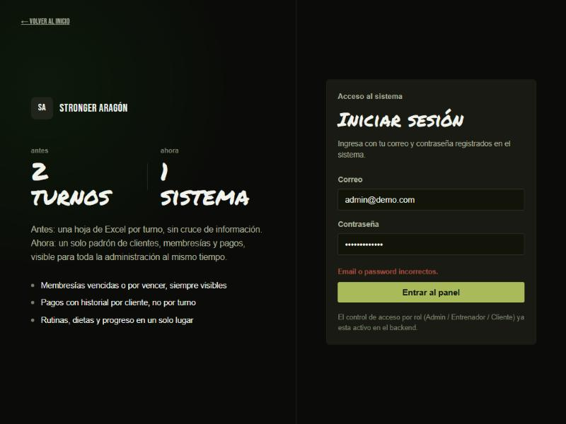

---

## 7. Aviso importante

Las 3 cuentas de prueba (`admin@demo.com`, `entrenador@demo.com`,
`cliente@demo.com`, todas con la contraseña `Demo2026!`) y todos los
datos que crea `seed.py` (planes, servicios, el cliente de ejemplo, su
rutina y su dieta) son **datos de demostración**, pensados únicamente
para probar el sistema. Antes de usar SmartGym v2 con clientes y pagos
reales:

- Cambia o elimina las 3 cuentas de prueba.
- No vuelvas a correr `python seed.py` sobre una base de datos con
  información real — es destructivo a propósito (borra y vuelve a crear
  los datos de prueba cada vez que se ejecuta).
- Genera un `JWT_SECRET` propio y distinto al que trae `.env.example`
  (el propio archivo ya lo advierte: ese valor es "solo desarrollo").
- Cambia las contraseñas de PostgreSQL (`POSTGRES_PASSWORD` en `.env`) a
  algo que no sea el valor de ejemplo.

---

## Qué se probó y qué no se pudo verificar

Todo lo descrito en las secciones 1 a 7 se probó de principio a fin,
sobre dos copias nuevas y aisladas del sistema levantadas específicamente
para escribir este manual (no sobre un entorno ya en uso), incluyendo:

- Instalación completa desde cero: clonar, copiar `.env`, `docker
  compose up --build -d`, `alembic upgrade head`, `seed.py` — con cada
  comando y su salida real.
- Inicio de sesión con las 3 cuentas de prueba y también con una
  contraseña incorrecta (para documentar el mensaje de error real).
- Administrador: alta de cliente con membresía y pago inicial, cliente
  sin membresía + asignación posterior, contratar un extra, registrar un
  pago con desglose, cambiar de plan con vista previa (incluyendo que el
  extra ya incluido se cancela solo), crear/editar un plan,
  eliminar/desactivar un plan con membresías activas (se confirmó que se
  desactiva, no se borra), tablero de Membresías activas, Bitácora
  (incluyendo que el cambio de plan y el restablecimiento de contraseña
  quedaron ahí registrados), editar los datos de un cliente, restablecer
  su contraseña (confirmando con `curl` que la anterior deja de servir y
  la temporal nueva sí funciona), y baja completa de un cliente.
- Administrador (pantalla "Usuarios", agregada el 2026-11-18): crear una
  cuenta de entrenador desde la pantalla y confirmar con `curl` que esa
  cuenta nueva puede iniciar sesión, filtrar por rol, restablecer su
  contraseña y desactivarla/reactivarla (confirmando con `curl` que una
  cuenta desactivada no puede iniciar sesión mientras lo está), y que en
  la fila del propio admin no aparece el botón "Desactivar".
- Entrenador: qué ve en su panel, que "Clientes" le sale ya filtrado a
  solo sus clientes asignados, asignación de rutina y de dieta ya
  sembradas por `seed.py`, registro de progreso corporal, y que la
  pantalla "Usuarios" lo bloquea incluso entrando por URL directa.
- Cliente: que su panel es de solo lectura y que no ve pantallas de
  administración.
- Apagar (`docker compose stop`) y volver a encender (`docker compose up
  -d`) sin perder datos.
- Disparo manual de la revisión de vencimientos ("Revisar vencimientos
  ahora").
- Respaldo (`pg_dump`) y restauración (`psql`) completos de la base de
  datos, confirmando que el inicio de sesión seguía funcionando después.
- Dos problemas reales de la sección 6 (puerto ocupado, Docker Desktop
  apagado, error de migración con la base de datos caída) se
  reprodujeron de verdad, no se redactaron de memoria.

**Lo que NO se pudo verificar en vivo:**

- **La revisión automática de las 06:00 a. m. en su horario real** — se
  verificó el mecanismo (el botón manual "Revisar vencimientos ahora"
  dispara exactamente el mismo código), pero no se esperó hasta esa hora
  del reloj para ver el disparo automático ocurrir solo.
- **El tiempo del primer `docker compose up --build`** en una
  computadora sin ninguna imagen de Docker descargada previamente (en la
  máquina usada para esta verificación ya había descargas previas de
  `python:3.13-slim` y `node:22-alpine`, lo que pudo acelerar el primer
  build respecto a una computadora completamente nueva).
- **Crear un ejercicio nuevo, una rutina nueva desde cero o un plan de
  dieta nuevo desde cero** (se verificó la asignación de rutinas/dietas
  ya existentes en el catálogo de ejemplo, no la creación de un ejercicio
  o catálogo completamente nuevo).
- **Pantalla en blanco** — no se forzó este error a propósito; la causa
  y el diagnóstico descritos en la sección 6 se basan en cómo está
  construido el sistema (contenedor `frontend` aún arrancando, o un
  error de JavaScript visible en los registros), no en una reproducción
  real del síntoma.
